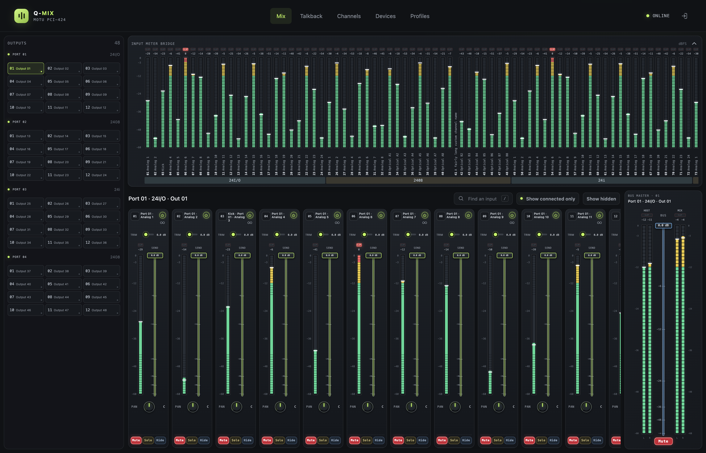

# snd-motu424

`snd-motu424` is an experimental out-of-tree ALSA driver for the MOTU
PCI-424, PCI-424X, and PCIe-424 family. Its purpose is to make these
multichannel audio interfaces usable from Linux: it configures the card and
AudioWire devices, and exposes PCM capture/playback, raw MIDI, and selected
hardware and mixer controls through ALSA.

The project also documents the reverse-engineering work behind the driver.
Some features remain experimental or have not been tested with hardware; the
[user guide](docs/USER_GUIDE.md) distinguishes verified behavior from known
limitations. Vendor firmware is required at runtime but is not distributed
here.

An optional user-space application, Q-Mix, provides a browser interface for
the driver's input-monitor mixer. It runs on the Linux host and can be used
from paired devices on a trusted LAN or VPN; it does not add networking to the
kernel driver.

## Q-Mix

Q-Mix is an optional user-space application for controlling the driver's input
monitor mixer. It runs on the Linux mixer host and serves a browser interface
to devices on a trusted LAN or VPN.

The [Q-Mix overview](docs/QMIX.md) explains the Mix, Devices, Channels, and
Profiles surfaces and includes screenshots. See the [Q-Mix installation and
operation guide](linux/snd-motu424/qmix-ui/README.md) for requirements,
build instructions, pairing, TLS, and network restrictions.

## Documentation

| Audience | Start here |
|---|---|
| Installing and using the driver | [Driver user guide](docs/USER_GUIDE.md) |
| Operating Q-Mix | [Q-Mix guide](linux/snd-motu424/qmix-ui/README.md) and [surface overview](docs/QMIX.md) |
| Understanding the reverse-engineered implementation | [Technical documentation index](docs/README.md) |
| Research provenance | [Reverse-engineering statement](docs/REVERSE_ENGINEERING.md) |

The driver and Q-Mix are experimental. Several controls and supported
interfaces have not been hardware-tested; consult the status tables and
limitations in the user guide before use.

## Firmware

Vendor firmware is not included. The driver requires firmware extracted from
an installer obtained by the user; see the [user guide](docs/USER_GUIDE.md).
The extraction script does not grant rights to the installer or firmware.

## License

Copyright (C) 2026 Andreas Tell and contributors.

Unless a file says otherwise, project-authored software and documentation in
this repository are licensed under [GPL-2.0-only](LICENSE). Vendor firmware
and other third-party material are not covered by that project license.
