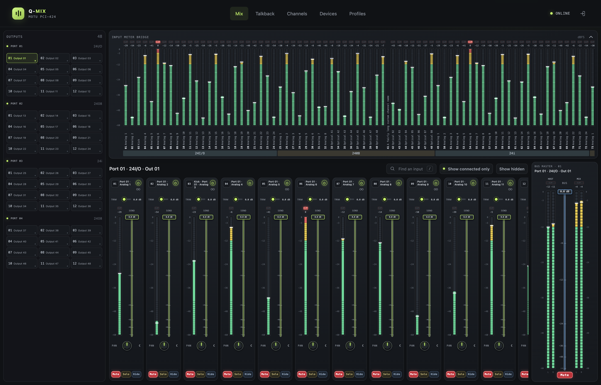
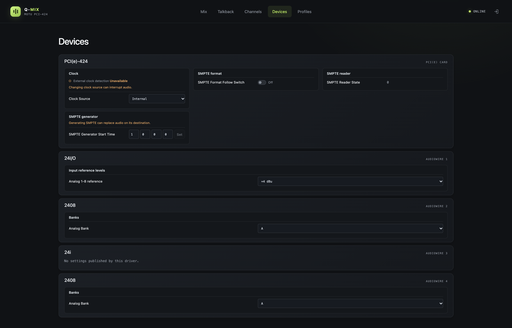

# Q-Mix interface overview

Q-Mix is an optional user-space mixer for the `snd-motu424` ALSA controls. It
runs on the Linux host and can be accessed by paired browsers on a trusted
LAN or VPN.

The screenshots use synthetic data for illustration; they do not show a live
hardware session or a saved user configuration.

## Mix

The Mix page presents the input meter bridge above horizontally scrolling
input strips. The bridge groups the 96 physical inputs into AudioWire device
ranges, and can be collapsed to leave more room for the strips. Each strip
controls an input's global trim and switch plus its route to the selected
stereo output bus. The output selector and bus master remain available beside
the strips. Meter values are DSP peaks; the display decay and peak-hold
behavior are UI presentation, not a claim of full standards compliance.

## Devices

The Devices page shows active card and AudioWire settings for recognized
hardware. Only settings exposed by the driver appear. A value shown after a
write is driver readback and does not necessarily confirm the hardware accepted
the change; some interface updates are asynchronous.

## Channels and Profiles

The Channels page stores custom names and stereo-pair/hidden-strip preferences
on the mixer host. Names and these display preferences are shared by browsers
connected to that service. The Profiles page stores mixer-control snapshots;
selecting a profile previews it, and applying it requires explicit
confirmation.

See the [Q-Mix README](../linux/snd-motu424/qmix-ui/README.md) for setup,
authentication, TLS, and the complete operational notes.
